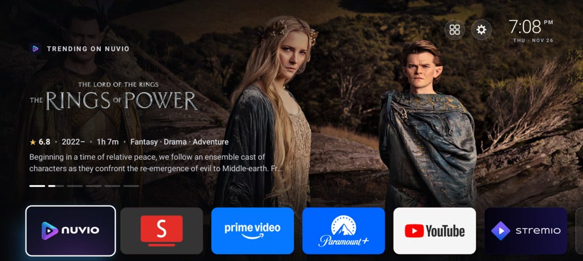
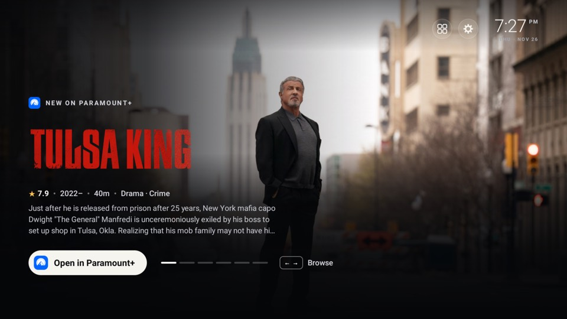
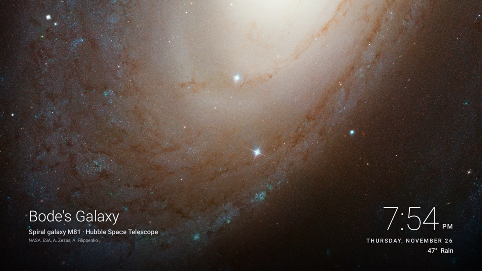
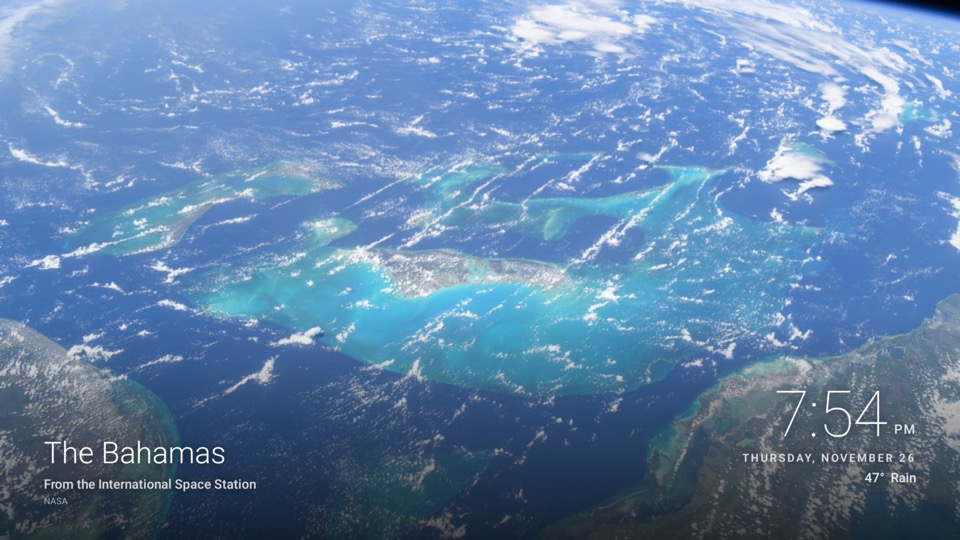

# Marquee

A fast, cinematic home screen for Android TV, built on an NVIDIA Shield TV Pro. Real app banners, featured
titles with proper title art, Continue Watching straight from your apps, and a screensaver of Webb, Hubble
and Space Station photography.



## What it does

- **Your apps, with their real banners.** The row uses each app's own Android TV banner and glows in its colors.
  Hold OK on an app to move it, remove it from Home, or open App info. In All apps, hold OK on anything to add it.
- **Featured titles.** The top of the screen rotates through what's popular for the app you're on, with the
  title's logo, rating, year, runtime and genres. Press **Up** to bring it full screen, **Left/Right** to browse,
  **OK** to open it in that app:
  - Nuvio and Stremio open the title's page
  - Paramount+ opens the show's page
  - Prime Video opens its search with the title at the top
- **Continue Watching** from the rows Nuvio and Stremio publish to Android TV, with progress bars.
- **App rows**: apps that publish their own Android TV row (Paramount+, Netflix and others) show it under their
  banner, and OK opens straight into the app.
- **Back never leaves Home**, and pressing Home while you're on Home jumps back to the first app.
- **Marquee Space screensaver**: 58 hand-picked photos from the James Webb and Hubble space telescopes and the
  International Space Station. A new one dissolves in every 40 seconds with a slow drift. Each photo's name and
  credit fade in, then out. A big clock, the date and the current weather stay on screen.
  Nothing repeats until you've seen them all, and the text moves slightly so nothing sits in one place.







## Install

Needs Android TV 11 or later. Build with JDK 17+ and the Android SDK (API 36):

```sh
./gradlew assembleRelease
adb install -r app/build/outputs/apk/release/app-release.apk

# Let Marquee read the rows other apps publish (Continue Watching, app rows)
adb shell pm grant com.marquee.launcher android.permission.READ_TV_LISTINGS

# Make Marquee the home screen
adb shell cmd package set-home-activity com.marquee.launcher/.MainActivity

# Optional: use the space screensaver (or pick "Marquee Space" in Settings > Device Preferences > Screen saver)
adb shell settings put secure screensaver_components com.marquee.launcher/.space.SpaceDream
```

Release builds are signed with your machine's debug key, which is fine for installing on your own TV.

After updating Marquee, Android sometimes forgets which app is Home and asks you to pick one. Run the
`set-home-activity` line again.

If your TV keeps going back to its stock launcher, you can turn the stock one off. This is reversible with
`pm enable`. The package name depends on the device; on a Shield it is `com.google.android.tvlauncher`:

```sh
adb shell pm disable-user --user 0 com.google.android.tvlauncher
```

## Configuration (optional)

Out of the box, featured titles for Nuvio and Stremio come from Cinemeta's public popular lists. For richer,
per-app catalogs (trending, new on Prime Video, Paramount+ or Netflix), point Marquee at your own
[AIOMetadata](https://github.com/cedya77/aiometadata) addon in `local.properties`:

```properties
marquee.aiometadata=https://<your-aiometadata-host>/stremio/<your-config-id>
```

The catalog IDs Marquee asks for are in `app/src/main/java/com/marquee/launcher/data/Catalogs.kt`. Replace them
with the IDs from your addon's `manifest.json`. `local.properties` is git-ignored, so your config ID stays private.

The default Home row (Nuvio, SmartTube, Prime Video, Paramount+, YouTube, Stremio) is `AppRepo.defaultPinned` in
`Apps.kt`. Only apps you have installed show up, and you can rearrange it on the TV.

## Credits

- Screensaver photos are loaded from ESA/Webb and ESA/Hubble (CC BY 4.0) and NASA. Each photo's credit is shown
  on screen while it's up.
- Weather data by [Open-Meteo](https://open-meteo.com) (CC BY 4.0), for the city in the TV's time zone.
- Built with Kotlin, Jetpack Compose and [Coil](https://coil-kt.github.io/coil/).

App names and logos belong to their owners. Marquee isn't affiliated with NVIDIA, Google, Amazon, Paramount,
Nuvio or Stremio.

## License

[MIT](LICENSE)
